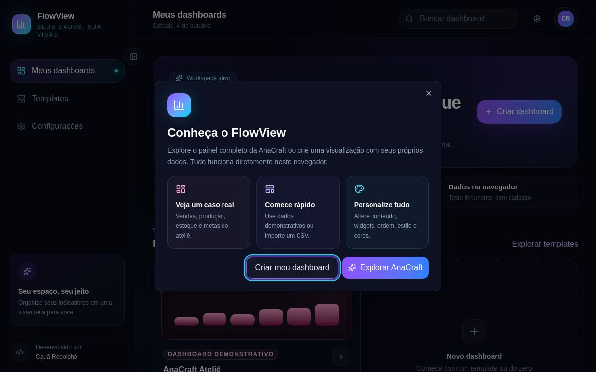

# FlowView



O **FlowView** é uma aplicação Front-End para criação e personalização de dashboards. A proposta é permitir que uma pessoa transforme seus próprios dados em indicadores, gráficos, tabelas e insights de uma maneira simples e visual.

O projeto possui dashboards especializados para **Finanças**, **Vendas** e **Marketing**, além de uma demonstração completa da **AnaCraft Ateliê**. Também é possível criar um painel personalizado, escolher o estilo visual, alterar cores, organizar widgets e exportar os resultados.

> Este projeto foi desenvolvido para o meu portfólio, com foco em React, TypeScript, arquitetura de componentes, responsividade e experiência do usuário.

## Demonstração

- **Projeto publicado:** [Acessar o FlowView](https://dashhub-caua.rodolfinhom5.chatgpt.site)
- **GitHub:** [CauaRodolpho](https://github.com/CauaRodolpho)
- **LinkedIn:** [Cauã Rodolpho](https://www.linkedin.com/in/cauã-rodolpho/)
- **Portfólio:** [Cauã Rodolpho — Front-End](https://portifolio-caua-rodolpho-hazel.vercel.app/)

## Sobre o projeto

A ideia do FlowView surgiu da vontade de criar um projeto que fosse além de uma interface com números aleatórios. O objetivo foi construir dashboards nos quais os dados cadastrados realmente alimentassem os cards, cálculos, gráficos, tabelas e insights.

Por exemplo, no dashboard financeiro, receitas e despesas são usadas para calcular automaticamente:

- saldo realizado;
- saldo projetado;
- contas a pagar e a receber;
- taxa de economia;
- maiores fontes de renda;
- categorias com mais gastos;
- evolução mensal.

O mesmo conceito é aplicado aos painéis de vendas e marketing. Dessa forma, cada visualização possui uma relação direta com os dados informados pelo usuário.

## Principais funcionalidades

### Hub de dashboards

- Visualização de todos os dashboards salvos.
- Pesquisa pelo nome ou descrição.
- Exclusão com opção de desfazer.
- Acesso rápido aos templates disponíveis.
- Sidebar recolhível, mantendo apenas os ícones quando fechada.

### Demonstração AnaCraft

A AnaCraft funciona como um estudo de caso pronto dentro do FlowView. Ela apresenta um cenário fictício de um ateliê, contendo:

- faturamento e pedidos;
- itens em produção;
- produtos e categorias mais vendidos;
- prazos de produção;
- alertas de estoque;
- progresso da meta mensal;
- pedidos recentes;
- insights do período.

Essa demonstração permite conhecer o produto sem precisar cadastrar dados logo no primeiro acesso.

### Criação de dashboards

O fluxo de criação foi dividido em três partes principais para evitar um formulário longo e cansativo:

1. Escolha do objetivo e do tipo de dashboard.
2. Inserção manual, preenchimento demonstrativo ou importação dos dados.
3. Escolha da apresentação, das cores e das visualizações.

Os cálculos personalizados continuam disponíveis depois da criação e são opcionais.

### Dashboard financeiro

- Cadastro de receitas e despesas.
- Categorias personalizáveis.
- Movimentações únicas ou recorrentes.
- Controle de itens pagos, recebidos ou pendentes.
- Saldo realizado e projetado.
- Planejamento mensal e meta de economia.
- Gráficos de evolução e distribuição por categoria.
- Insights calculados a partir das movimentações.

### Dashboard de vendas

- Cadastro e edição de pedidos.
- Produtos, categorias e canais de venda.
- Clientes novos e recorrentes.
- Descontos, frete e receita líquida.
- Filtros por status e pesquisa de pedidos.
- Ticket médio, unidades vendidas e taxa de cancelamento.
- Comparação entre produtos, categorias e canais.

### Dashboard de marketing

- Cadastro e edição de campanhas.
- Período e situação da campanha.
- Investimento, impressões, cliques e leads.
- Conversões e receita atribuída.
- Cálculo de CTR, custo por lead, conversão e ROI.
- Comparação entre canais.
- Metas de investimento, leads e conversões.

### Personalização

- Alternância entre os temas claro e escuro.
- Escolha das cores principais do dashboard.
- Diferentes estilos de apresentação.
- Ativação e ocultação de widgets.
- Alteração do tamanho dos blocos.
- Reorganização dos widgets.
- Perfil e preferências do workspace.

### Importação e exportação

- Importação de arquivos CSV.
- Prévia dos dados antes da criação.
- Associação automática de colunas conhecidas.
- Exportação em CSV.
- Backup dos dados em JSON.
- Geração de resumo em PNG.
- Impressão ou salvamento em PDF pelo navegador.

## Como utilizar

1. Acesse o Hub principal.
2. Abra a AnaCraft para explorar uma demonstração completa.
3. Entre em **Templates** ou clique em **Criar dashboard**.
4. Escolha entre Financeiro, Vendas, Marketing ou Personalizado.
5. Cadastre os dados, importe um CSV ou use o preenchimento de demonstração.
6. Escolha o estilo e as cores do painel.
7. Edite os registros e acompanhe a atualização dos indicadores.
8. Personalize os widgets e exporte o resultado quando quiser.

As alterações são armazenadas no próprio navegador e continuam disponíveis depois que a página é recarregada.

## Tecnologias utilizadas

| Tecnologia | Utilização no projeto |
| --- | --- |
| React 19 | Componentes, estados e construção das interfaces |
| TypeScript | Tipagem de dashboards, registros, fórmulas e preferências |
| Next.js | Estrutura principal e carregamento da aplicação |
| Vinext + Vite | Ambiente de desenvolvimento e geração do build |
| Tailwind CSS | Design system, temas e responsividade |
| Recharts | Gráficos de área, barras e rosca |
| Lucide React | Ícones da interface |
| Radix UI | Base acessível dos modais, abas, switches e painéis |
| LocalStorage | Persistência dos dados sem necessidade de backend |
| Node Test Runner | Testes automatizados das regras do projeto |

## Arquitetura

```text
FlowView/
├── app/
│   ├── globals.css              # tokens, temas e estilos globais
│   ├── layout.tsx               # layout e metadados
│   └── page.tsx                 # entrada da aplicação
├── components/
│   ├── dashboard/               # AnaCraft e componentes compartilhados
│   ├── layout/                  # sidebar, cabeçalho e navegação móvel
│   ├── settings/                # perfil, tema e diálogos do workspace
│   ├── ui/                      # componentes de interface utilizados
│   ├── dashboard-app.tsx        # controle do Hub e das páginas
│   ├── dashboard-studio.tsx     # dashboard personalizado
│   ├── finance-dashboard.tsx    # domínio financeiro
│   ├── sales-dashboard.tsx      # domínio de vendas
│   └── marketing-dashboard.tsx  # domínio de marketing
├── data/                        # templates e dados demonstrativos
├── hooks/                       # estado e persistência do workspace
├── lib/
│   ├── calculations/            # regras de cálculo por domínio
│   ├── export.ts                # exportações compartilhadas
│   └── formatters.ts            # formatação de moeda, datas e números
├── tests/                       # testes automatizados
└── types/                       # tipos e interfaces TypeScript
```

O componente central controla a navegação e decide qual experiência deve ser exibida. Os painéis especializados são carregados sob demanda e cada domínio possui suas próprias regras de cálculo.

## Decisões técnicas

### Por que o projeto não possui backend?

O objetivo do FlowView é demonstrar habilidades de Front-End. Por isso, preferi concentrar o trabalho em interface, manipulação de dados, arquitetura React, tipagem, responsividade e experiência do usuário.

Os dados ficam no `localStorage`, permitindo testar todo o fluxo sem criar conta ou configurar um servidor.

### Separação entre interface e cálculos

As regras financeiras, comerciais e de marketing foram colocadas em funções separadas dos componentes React. Isso evita deixar cálculos importantes misturados com o JSX e permite testá-los sem precisar renderizar a interface.

Por exemplo, o cálculo da receita líquida de uma venda é reutilizado nos cards, gráficos, tabelas e insights daquele dashboard.

### Persistência versionada

O workspace salvo no navegador possui uma versão. Quando a estrutura dos dados muda, a aplicação consegue normalizar informações antigas e aplicar valores seguros em campos ausentes ou inválidos.

### Carregamento sob demanda

Os dashboards especializados são importados dinamicamente. Assim, a tela inicial não precisa carregar imediatamente todo o código de Finanças, Vendas e Marketing.

### Design system

As cores principais foram organizadas em tokens semânticos, como superfície, texto, borda, destaque e estado destrutivo. Isso ajuda a manter o tema claro e o escuro consistentes e reduz estilos repetidos.

## Responsividade e acessibilidade

O FlowView foi pensado para funcionar em computador, tablet e celular.

- Sidebar adaptada para menu móvel.
- Navegação inferior em telas menores.
- Botões com área adequada para toque.
- Tabelas com rolagem horizontal.
- Gráficos ajustados ao tamanho do container.
- Formulários reorganizados conforme a largura disponível.
- Estados de foco visíveis.
- Textos e controles com contraste entre os temas.
- Rótulos acessíveis em botões que utilizam apenas ícones.
- Suporte à preferência de movimento reduzido do sistema.

## Testes e qualidade

O projeto possui **23 testes automatizados**, cobrindo principalmente as regras que não podem gerar resultados incorretos:

- resumo financeiro e agrupamento de despesas;
- receita líquida e resumo de vendas;
- funil e retorno de marketing;
- leitura e transformação de CSV;
- criação e clonagem de dashboards;
- busca e restauração de itens excluídos;
- perfil do workspace;
- persistência e migração do `localStorage`.

Antes da publicação, o projeto foi validado com:

```bash
pnpm exec tsc --noEmit
pnpm lint
pnpm test
pnpm build
```

## Principais desafios

### Transformar dados em informações úteis

No início, alguns dashboards apresentavam números sem uma relação clara entre eles. Para resolver isso, defini dados específicos para cada domínio e fiz com que todas as visualizações partissem dos mesmos registros.

### Simplificar a criação

O primeiro fluxo possuía muitas etapas e perguntas parecidas. Ele foi reduzido para deixar as decisões mais importantes durante a criação e permitir que detalhes avançados sejam editados depois.

### Manter o tema claro legível

Alguns componentes foram criados inicialmente pensando no fundo escuro. A solução foi organizar as cores com tokens semânticos e revisar superfícies, textos, bordas, modais e estados selecionados no tema claro.

### Trabalhar com gráficos responsivos

Os gráficos precisavam funcionar dentro de diferentes widgets e tamanhos de tela. Foram definidos containers com dimensões mínimas, limites de altura e layouts adaptáveis para evitar cortes ou renderização incorreta.

### Organizar o código

O componente principal chegou a concentrar muitas responsabilidades. A estrutura foi reorganizada, separando o shell da aplicação, os diálogos, a experiência AnaCraft, os cálculos e as funções compartilhadas de exportação e formatação.

## O que aprendi

Durante o desenvolvimento deste projeto, pratiquei principalmente:

- modelagem de dados com TypeScript;
- organização de componentes React;
- separação entre regras de negócio e interface;
- persistência e migração de dados locais;
- criação de layouts responsivos;
- construção de temas claro e escuro;
- importação e exportação de arquivos;
- testes de funções e cálculos;
- tratamento de estados vazios e dados inválidos;
- melhoria de uma interface a partir de revisões de UX.

## Executando localmente

### Requisitos

- Node.js 22 ou superior.
- pnpm instalado.

### Instalação

Depois de clonar ou baixar este repositório, execute:

```bash
pnpm install
pnpm dev
```

Depois, abra o endereço informado no terminal.

## Limitações atuais

- Os dados ficam disponíveis somente no navegador utilizado.
- Não existe sincronização entre dispositivos.
- Limpar os dados do navegador também remove os dashboards locais.
- O projeto não possui autenticação ou banco de dados.
- A importação CSV depende de cabeçalhos que possam ser identificados.
- O backup JSON ainda não possui um fluxo de restauração pela interface.
- O FlowView é uma demonstração de Front-End e não deve ser tratado como sistema financeiro real.

## Possíveis melhorias futuras

- Gerar insights com inteligência artificial.
- Restaurar dashboards através do backup JSON.
- Importar arquivos Excel.
- Criar mais opções de widgets.
- Adicionar testes de componentes e fluxos completos.
- Permitir compartilhamento público de dashboards.
- Criar sincronização opcional com uma API.

Essas melhorias ficaram fora do escopo atual para manter o foco na experiência Front-End e evitar adicionar funcionalidades apenas para aumentar o tamanho do projeto.

## Autor

Desenvolvido por **Cauã Rodolpho**, estudante de Análise e Desenvolvimento de Sistemas com foco em desenvolvimento Front-End.

- [GitHub](https://github.com/CauaRodolpho)
- [LinkedIn](https://www.linkedin.com/in/cauã-rodolpho/)
- [Portfólio](https://portifolio-caua-rodolpho-hazel.vercel.app/)

Se você tiver algum feedback sobre o projeto, ficarei feliz em receber.
